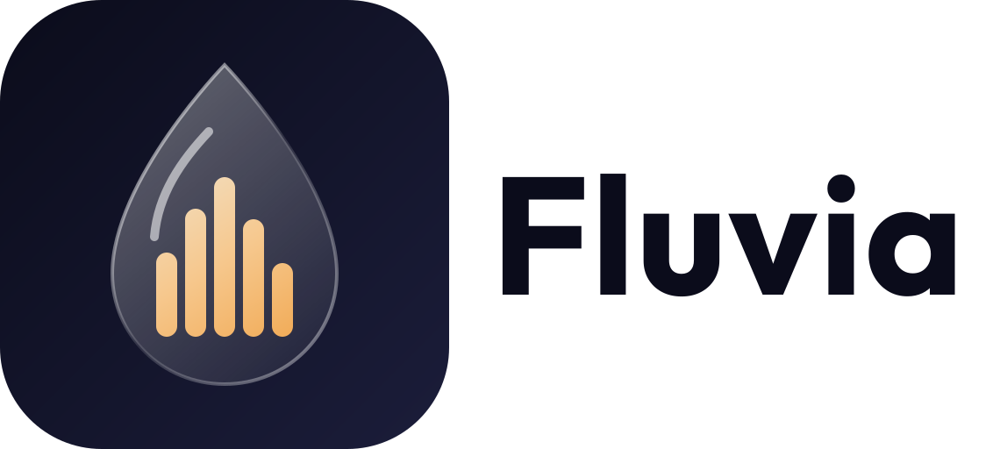

<picture>
  <source media="(prefers-color-scheme: dark)" srcset="assets/fluvia/fluvia-logo-dark.svg">
  
</picture>

<h3>A customisable, glass-styled YouTube Music client for Android</h3>

  
  
  

Made by <a href="https://aashishpandey.com">Aashish Pandey</a> · a fork of <a href="https://github.com/MetrolistGroup/Metrolist">Metrolist</a>

 

> [!WARNING]
> 

>   
Using Fluvia to access YouTube Music may violate YouTube's Terms of Service.

>   
You use Fluvia at your own risk and are solely responsible for any consequences, including action against your account. The maintainer is not liable for damages, claims or actions against your account.

> 

>
> YouTube Music is region-restricted. If the service is unavailable in your region, you need a [VPN or proxy in a supported region](https://one.one.one.one/) to use the app.

> [!NOTE]
> Fluvia is an early build. CI compiles it, but it has not been tested on a device.

<h1>About Fluvia</h1>

Fluvia is an Android-only fork of Metrolist with its own look and deep appearance customisation. It keeps Metrolist's playback, library and sync code, and replaces the upstream UI in place. Fluvia does not track upstream UI changes. The fork lives on the `feat/fluvia-design-system` branch and builds as `io.github.aashisharyan2595.fluvia`. Made by [Aashish Pandey](https://aashishpandey.com).

### What the design system adds

- **Looks:** six presets (Midnight Frost, Paper Light, Neon Night, Album Glow, Forest Quiet, Sunset Pop) plus a Custom look. Applying a look sets the accent, background, glass level, corners and fonts together.
- **Appearance settings:** accent and background colours (including hex entry), glass blur, tint and edge sliders, corner style, spacing density, display size, text scale and icon style.
- **Glass tiers:** Full, Frosted and Solid, so devices without strong blur support can fall back.
- **Contrast guard:** text and accent colours are adjusted to keep readable contrast (4.5:1 for text, 3:1 for UI elements), and rows show when a colour was adjusted.
- **Fonts:** 36 bundled font families, with the Outfit family as the default.
- **Icon packs:** six packs (Fluvia, Lucide, Feather, Tabler, Phosphor and Material). Licences for icon packs and fonts are listed under About.

### Not built yet

- The glass surface effect (`Modifier.fluviaGlass`) and its backdrop dependency.
- Background rendering for the Aurora, Mesh, Solid and Album art styles.
- Applying the spacing scale across screens.
- Fixes for known gaps: high-contrast support, widgets still gating on Material You, and pure black on dark looks.

### Build the APK

Fork CI builds on GitHub's `ubuntu-latest` runner. In the repository's Actions tab, run **Build Android** with the `debug` variant on the `feat/fluvia-design-system` branch, then download the `android-build` artifact from the run. To build locally, install a JDK and the Android SDK and run `./gradlew :androidApp:assembleDebug`.

The design and plan are in [docs/superpowers/specs](docs/superpowers/specs/2026-11-24-fluvia-design-system-design.md) and [docs/superpowers/plans](docs/superpowers/plans/2026-11-24-fluvia-design-system.md).

 

<!---

DO NOT REMOVE THIS SECTION, I WANT TO ADD IT LATER!!!
---

<h1>Screenshots</h1>

-->

<h1>Features</h1>

Fluvia adds the appearance features at the end of this list. Everything else is inherited from Metrolist, and some of it, such as iOS and desktop support, is not part of Fluvia.

- YouTube Music playback with or without signing in
- Android 7+, iOS 15+, Windows 10+, macOS 15+ and Linux support
- Material 3 Expressive base, being replaced by the Fluvia design system
- Discord Rich Presence and scrobbling through Last.fm and ListenBrainz
- No ads
- Listen Together for shared playback online
- Casting to Google Cast, F-Cast and SONOS devices, and over DLNA (Android and desktop)
- Backup and playlist imports from 30+ clients and 6 services
- Music recognition through Shazam
- Lyrics with translation and romanization
- Translations in over 15 languages
- Video playback (Android and desktop)
- Content filters for AI-generated content, explicit-only playback and SFW-only playback
- Canvas from Apple Music, Spotify and YouTube Music
- Player, thumbnail, miniplayer and background styles
- Custom fonts and app icons
- **Fluvia:** Looks presets, glass tiers, contrast guard, 36 fonts and six icon packs on Android

> [!TIP]
> 
See the <a href="https://metrolist.cc/#faq">FAQ</a> for common questions.

 

<h1>Download Fluvia</h1>

Fluvia has no published releases yet. To get an APK, open <a href="https://github.com/aashisharyan2595/Fluvia/actions/workflows/build-android.yml">Actions, Build Android</a>, choose <b>Run workflow</b> with the <code>debug</code> variant, then download the <code>android-build</code> artifact from the finished run. See <a href="#about-fluvia">About Fluvia</a> for local builds.

 

<h1>Special thanks</h1>

Metrolist uses these projects and services.

<table>
  <thead>
    <tr>
      <th align="center">Project</th>
      <th align="center">Contribution</th>
    </tr>
  </thead>
  <tbody>
    <tr>
      <td align="center"><a href="https://github.com/aleksey-saenko/MusicRecognizer">MusicRecognizer</a></td>
      <td>Music recognition through the Shazam API</td>
    </tr>
    <tr>
      <td align="center"><a href="https://github.com/MetrolistGroup/innertubex">InnerTubeX</a></td>
      <td>YouTube streaming engine, developed with help from <a href="https://github.com/ZemerTeam/">ZemerTeam</a></td>
    </tr>
    <tr>
      <td align="center">Lyprio</td>
      <td>Lyrics provider</td>
    </tr>
    <tr>
      <td align="center"><a href="https://github.com/MetrolistGroup/metroserver">metroserver</a></td>
      <td>Listen Together real-time synchronization backend</td>
    </tr>
    <tr>
      <td align="center"><a href="https://www.blacksmith.sh">Blacksmith</a></td>
      <td>GitHub Actions runners for CI</td>
    </tr>
  </tbody>
</table>

 

<h1>Metrolist translations</h1>

We use Weblate to translate Metrolist. <a href="https://hosted.weblate.org/projects/Metrolist/">Contribute a translation</a>.

 

<h1>Metrolist contributors</h1>

To contribute code, start with the <a href="docs/README.md">developer docs</a>.

 

<h1>Fluvia credits</h1>

- **Metrolist:** Fluvia is a fork of [Metrolist](https://github.com/MetrolistGroup/Metrolist) by [the Metrolist development team](https://github.com/MetrolistGroup). Playback, library, sync, lyrics and Listen Together come from upstream, and contributor history is preserved in git.
- **Upstream projects and services:** [MusicRecognizer](https://github.com/aleksey-saenko/MusicRecognizer) (Shazam recognition), [InnerTubeX](https://github.com/MetrolistGroup/innertubex) (YouTube streaming engine, built with help from [ZemerTeam](https://github.com/ZemerTeam/)), Lyprio (lyrics), [metroserver](https://github.com/MetrolistGroup/metroserver) (Listen Together backend) and translators on [Weblate](https://hosted.weblate.org/projects/Metrolist/).
- **Icon packs:** [Lucide](https://lucide.dev) (ISC, Lucide Icons and Contributors), [Feather](https://feathericons.com) (MIT, Cole Bemis), [Tabler Icons](https://tabler.io/icons) (MIT, Paweł Kuna), [Phosphor](https://phosphoricons.com) (MIT, Phosphor Icons) and [Material Symbols](https://fonts.google.com/icons) (Apache-2.0, Google). The Fluvia pack is original to Metrolist under GPL-3.0. Versions and licence texts are in [the icon pack notices](shared/src/commonMain/composeResources/files/licenses/icon-packs/NOTICE.md).
- **Fonts:** 36 families from Google Fonts, bundled unmodified under SIL OFL 1.1 through the `@expo-google-fonts` packages. Each copyright line is in [the font licences](shared/src/commonMain/composeResources/files/licenses/fonts/LICENSES.md).
- **Design and build:** Fluvia's design system was planned and written with Claude (Anthropic) and directed by [Aashish Pandey](https://aashishpandey.com).

<h1>Fluvia disclaimer</h1>

Fluvia is an independent fork. It is not affiliated with, funded, authorized or endorsed by the Metrolist project, YouTube, Google LLC, or their affiliates. Fluvia is not a registered trademark, and the name may change.

Using Fluvia to access YouTube Music may violate YouTube's Terms of Service. You use it at your own risk and are solely responsible for any consequences, including action against your account. The maintainer is not liable for damages or claims. YouTube Music is region-restricted, so you may need a VPN or proxy in a supported region.

All trademarks, service marks and intellectual property referenced here belong to their owners. Icon and font licences apply to those assets, and Fluvia's own code stays under GPL-3.0. Upstream Metrolist has its own credits and disclaimer, kept in the sections around this one.

 

> [!WARNING]
> <h2>Legal disclaimer</h2>
> 
This project is not affiliated with, funded, authorized or endorsed by YouTube, Google LLC, MetroList MLS, or their affiliates and subsidiaries.

>
> 
All trademarks, service marks, and intellectual property rights referenced in this project belong to their respective owners.

 

**Fluvia by [Aashish Pandey](https://aashishpandey.com)**

**Based on [Metrolist](https://github.com/MetrolistGroup/Metrolist) by [the Metrolist development team](https://github.com/MetrolistGroup)**

